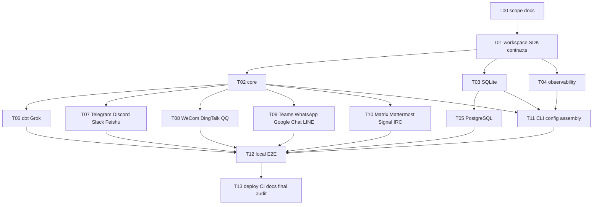

# Relanox implementation TODO

Scope: all 15 native text channels, dot/Grok, SQLite/PostgreSQL, observability, resident CLI/deployment. No real accounts: SDK/documented typed boundaries and local protocol E2E. See [PRD](docs/PRD.md), [architecture](docs/ARCHITECTURE.md), [dependencies](docs/DEPENDENCIES.md), [test rules](AGENTS.md).

## Dependency graph

Each task uses a fresh `.worktree/<task>` after prerequisites land on master. Independent tasks run concurrently within available slots. Root reviews/integrates coherent commits, verifies/pushes, and removes completed worktrees. Tasks may be subdivided into fresh worktrees for bounded ownership.

## Checklist

- [x] T00: reconcile PRD/architecture/dependencies, final scope/test policy; docs commit and push master.
- [x] T01: pnpm/TypeScript/Vitest workspace; SDK message/Host/Storage/Channel/Agent/Observability contracts; toolchain and lockfile.
- [ ] T02: validated config/secrets/bindings; scoped Host APIs; worker, retries, health, retention and explicit recovery; immutable targets.
- [ ] T03: SQLite schema/migrations/atomic operations; shared storage contract suite; restart and conflict behavior.
- [ ] T04: observability-standard, safe no-op/error isolation, logs/metrics/optional bounded traces; redaction/public contract tests.
- [ ] T05: PostgreSQL same storage contract; real temporary PostgreSQL tests.
- [ ] T06: dot Events subscription/challenge/signing/lifecycle and MCP tools; Grok text Webhook and MCP tools; typed SDK/protocol tests.
- [ ] T07: Telegram, Discord, Slack, Feishu native text receive/send; authentication, targets, errors, connection lifecycle and Vitest protocol tests.
- [ ] T08: WeCom, DingTalk, QQ native text receive/send; protocol auth, window/sequence semantics, reconnect and Vitest tests.
- [ ] T09: Teams, WhatsApp, Google Chat, LINE native text receive/send; JWT/signatures, delayed targets/windows and Vitest tests.
- [ ] T10: Matrix, Mattermost, Signal, IRC native text receive/send; lifecycle, identity and declared limitations; Vitest tests.
- [ ] T11: CLI assembly of all plugins; validate/migrate/run/status/doctor/requeue; lifecycle, health/metrics, config examples and CLI tests.
- [ ] T12: production core/storage HTTP/socket peer E2E: dispatch/claim/complete/outbound, endpoint isolation, restart and unknown-send recovery.
- [ ] T13: Docker/Compose, CI with PostgreSQL, user/developer/operator docs, dependency/license audit; full build/typecheck/lint/Vitest/E2E/deployment checks; push final master and clean worktrees.

## Test admission and completion

Record the four required test answers before implementation in `docs/testing/<task>.md`. Only mark tasks done after integration and verification. Local peers represent external protocols, never Relanox business logic. No live-account credentials are needed; platform labels remain experimental until real accounts are independently tested. Media and other expressly excluded features are not unfinished tasks.

## Evidence

Integration commits and check results will be recorded here as work completes.

- T00: ab1a61b / 39ed410 pushed master; native scope, protocol sources and test policy finalized.
- T01: 7f4abde integrated; build/typecheck pass. Root lint exclusion corrected in 83ddc98; runtime tests begin with behavioral modules, no synthetic SDK tests.
