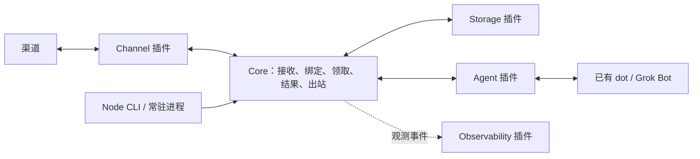

# Relanox 轻量消息转发架构

日期：2026-10-11。状态：实现基线；按 TODO 开发，真实账户联调不在本次验收范围。本文件是唯一架构维护文档；[PRD](PRD.md)与本文共同定义当前交付，进度见 [TODO](../TODO.md)。

导航：[首版](#relay-scope) · [边界](#core-architecture) · [接口](#interfaces) · [持久流程](#durability) · [存储](#storage) · [可观测性](#observability) · [部署](#deployment) · [dot](#agent-dot) · [Grok](#agent-grok) · [实现顺序](#validation) · [依赖审计](DEPENDENCIES.md) · [原生渠道计划](#channel-source-audit)

## 1. 首版范围

Relanox 把渠道文字交给用户已有的托管 Agent，再把异步结果发回原会话。只负责接入、固定绑定、持久交接和回包；不运行本地模型，不复制 Agent 的工具、记忆、计划任务或推理系统。

| 项目 | v0.1 交付边界 |
|---|---|
| 用户与消息 | 单个自托管实例；静态账号/绑定/发送者 allowlist；每条输入对应一个最终文字结果 |
| 渠道 | 全部 15 个原生文字渠道，见附录 C；按平台保留会话/线程/引用、权限、窗口与分片语义 |
| Agent | 用户已有 dot、已有 Grok Bot，各自独立插件；SDK/文档强类型边界和本地协议 E2E |
| 存储 | SQLite（默认）、PostgreSQL 两个插件；每个部署选择一个权威库 |
| 可观测性 | 独立 Observability 插件；JSON 日志、Prometheus 指标、可选 OTLP traces；存活/就绪检查 |
| 部署 | 常驻 Node 服务，直接运行或容器部署；支持 HTTP 与平台长连接 |
| 运维 | 配置校验、迁移、查看待处理/失败/未知结果、显式重新排队；不做管理面板 |

部署统一为常驻 Node，不提供功能受限的 Serverless 版本。Grok 默认直接通过 Webhook 传入正文，MCP 用于领取确认和结果回传；dot 按 Events + Tools 协议工作。本次不做真实账户联调；实现与本地协议测试全部完成，账户能力仍明确标实验性。

全部渠道纳入本次实现，不再区分未来 A/B/C 批次。媒体、卡片、交互命令、编辑、流式输出、消息聚合、多租户、动态插件安装和热升级不进入本次范围。统一直接使用平台协议或经审计 SDK；OpenClaw 及外置插件仅作源码参考，不提供兼容、运行时加载或配置迁移。

## 2. 一套核心，四类插件

| 模块 / 计划 npm 包 | 负责 | 边界 |
|---|---|---|
| `packages/sdk` / `@relanox/sdk` | 消息、目标地址、HostContext 和四类插件契约 | 无数据库驱动、平台 SDK 或运行时装配 |
| `packages/core` / `@relanox/core` | 配置/allowlist/绑定、接收去重、领取、结果关联、重试决策、HTTP 路由、单批 processDue | 不 import 渠道实现、Agent 实现或 SQL 驱动；不承担 listener 和进程生命周期 |
| `plugins/channel-*` / `@relanox/channel-*` | 平台验签、消息规范化、独立发送、平台错误/回执映射 | 不选择 Agent，不调模型，不直接写数据库 |
| `plugins/agent-*` / `@relanox/agent-*` | dot/Grok 的认证与传输协议、提交消息或提醒、MCP 工具映射 | 不向聊天渠道发送，不拥有第二套任务状态机 |
| `plugins/storage-*` / `@relanox/storage-*` | 三类持久记录、固定业务事务、索引、迁移 | 不决定授权、路由、重试策略，不调用外部服务 |
| `plugins/observability-*` / `@relanox/observability-*` | 日志、指标和 trace 实现与导出，首个为 observability-standard | 不改变业务状态，不决定重试，不直接访问业务表，不接收正文 |
| `apps/cli` / `@relanox/cli` | Node 配置装配、listener、timer、常驻连接与管理命令 | 调用同一 core，不重写业务流程 |

依赖方向是 core/插件 → sdk，装配入口 → core/选定插件。Channel 和 Agent 只通过 HostContext 接收/领取/完成消息及访问命名空间协议状态。Storage 拥有表与迁移；core 拥有业务状态转换规则，Storage 用原子条件执行规则。日志和遥测实现归 Observability，core/其他插件仅调用 sdk 观测门面，不暴露 Pino/OTel 类型。认证、绑定、凭据引用保持在现有模块，不拆出 auth/router/secrets 包，也不建 client、testkit、通用 Jobs 或 Workflow 框架。

核心使用 Web Request/Response、fetch 和 Web Crypto。插件元数据只需要 id、kind、SDK 主版本、配置校验和运行环境/接收能力。setup 注册 handler；start/stop 仅用于常驻连接。迁移由部署命令执行，正确性不依赖进程内 Map、stop 或退出时 flush。

## 3. 最小接口与归属

以下是设计语义；TypeScript API 已定义于 `packages/sdk/src/index.ts`，精确事务语义见 [SDK 契约](SDK.md)。工具名为 Relanox 自定义，不是 Agent 平台预定义 API。

| 接口 | 语义 |
|---|---|
| Channel.setup / handleWebhook；可选 start / stop | 注册或执行 Request → Response；验签后调用 Host.ingest；不自行 listen |
| Host.ingest | 提交可信来源、稳定事件键、发送者、文字和目标；core 校验绑定/allowlist，存储成功后返回 receipt；重复返回原 receipt |
| Channel.send | 接收 deliveryId、目标和待发文字分片；返回 sent + 回执，或 retryable / rejected / unknown |
| Agent.setup / handleRequest | 注册自身协议/MCP 路由，按已认证主体限制 endpoint |
| Agent.dispatch | 接收已持久化的 requestId、正文与必要来源上下文；插件决定传正文（Grok）或提醒待办（dot）；返回 accepted / retryable / rejected / unknown |
| Host.listPending / claim | 按授权 endpoint 列表或领取；原子返回正文、requestId、claimToken；每 endpoint 最多一个活跃请求 |
| Host.complete / fail | 验证 requestId 和 claimToken；最终结果与 outbound 同事务提交；远端明确失败单独记录 |
| Host.mountHttp / state / log | 注册插件命名空间路由、访问协议状态、输出脱敏日志；没有直接 SQL 访问权 |
| Host.observe.log / count / record / span | 结构化日志、计数、数值与有界操作 span；Storage setup 也接收此门面；只使用受限字段 |
| Observability.setup / flush / shutdown | 返回观测门面与可选 metrics handler，管理有界导出；异常隔离，退出有截止时间 |
| Core.processDue | core 按批量/时长上限处理到期记录；Node 后台循环定期调用，提交后可立即触发一次扫描；业务事实始终在 Storage |

所有调用均为异步契约。Agent.dispatch 只表示一次短传输，不等待远端完成。仅在用户明确选择的 pull 备用模式下跳过 dispatch。core 统一领取/完成规则，避免为 Grok 的直接传正文另建一条处理链。

绑定键为 `(accountId, chatId, threadId)`。接纳时冻结 endpoint 和可序列化回复目标；后续改绑定不改变旧任务的归属。目标不能是内存闭包或只有短期 token 的回复句柄。核心不向 Agent 暴露渠道凭据，complete 不接受 Agent 任意指定的回复地址。

claimKey 标识远端一次领取尝试，同一尝试重试返回原令牌；不同尝试返回 busy。不要把 requestId 当作所有重复 Routine 共用的 claimKey。Agent 应在任何有副作用的处理前领取；工具协议不能保证模型必然遵守，因此不宣称远端执行恰好一次。首版每 endpoint 串行，只 dispatch 最早的可处理请求；complete/fail 后下一条成为 due，扫描也能恢复推进。排队消息仍保存在数据库；本地会话键不代表远端具备隔离会话。

## 4. 持久流程与恢复

配置保存账号、endpoint、绑定和 SecretRef；数据库只保留三个逻辑表。插件可用索引和内部约束实现事务，但不扩成独立 Message/Run/Job/Attempt/Journal 表族。

| 记录 | 内容 |
|---|---|
| inbound | 来源唯一键、正文、可信上下文、目标/endpoint 快照、requestId、pending/claimed/completed/failed、claimKey/token、最终结果、通知重试及短执行 lease/version |
| outbound | 唯一 request/result、目标、文字分片及进度、待发/sent/rejected/unknown、重试、短 lease/version、平台回执 |
| plugin_state | 插件/账号/键命名空间内的必要协议状态，例如 dot 订阅、到期时间与游标；不另存业务队列 |

1. Channel 验证来源，core 接纳并持久化；Webhook 在提交后 ACK，写库失败不确认成功。
2. processDue 原子取得到期请求的短 lease，调用 Agent.dispatch。Grok 在这一请求中收到消息正文；dot 收到事件后使用工具读取。accepted 只代表传输接受，不代表已领取或完成。
3. Agent 先 claim，再用已有能力处理。Grok 不需要先 listPending 来获得已经传入的正文；claim 只用于权限、去重和结果关联，也可返回保存的正文用于核对。
4. complete 校验处理令牌，原子保存最终结果并创建 outbound，立即返回工具回执；后续发送由同一 processDue 执行。
5. Channel 独立发送到冻结目标，保存每个分片的回执；确定临时失败才退避重试。发送窗口/权限失败保留结果，不重跑 Agent。

去重键包含平台、账号和稳定事件 ID。相同结果重试返回原结果；同 resultId 不同内容、第二个不同 final 均冲突。每个 endpoint 的活跃请求互斥由数据库保证。授权来自平台事件或 MCP 认证上下文，不能信任调用者填写 endpointId。

**短执行 lease 与长期 claim 分开。**短 lease/version 防止并发消费者重复结算；外部调用设置有界超时，旧 version 不得覆盖新状态。claimed 不因服务重启或计时超时释放。管理员显式重新排队会撤销旧 token；晚到结果不能覆盖新执行。没有真实远端查询/取消能力时，只能显示等待或本地撤销，不能声称远端已失败/停止。

数据库即待办来源，不再向外部队列重复写入。Node 后台循环定期扫描 due 记录；提交后可立即触发扫描以降低延迟。即使提交后进程退出，下次启动也会继续扫描。默认单进程，保留原子领取和版本校验处理并发回调与中断恢复，不为此新增 Executor 抽象或队列服务。

**平台发送结果未知时不盲目重发。**无幂等接口的平台在超时或“发送中”进程退出后进入 unknown；支持幂等/查询时才自动恢复，并复用同一分片键。版本 fencing 只能保护数据库，不能撤销已经发往平台的请求。Grok 未领取时可有限重试同一 requestId 的正文，但重复 Routine 仍可能有额外运行/费用；claimed 后停止自动触发该任务。

未完成请求与未送达结果不随普通清理删除；完成记录按保留期清理正文并保留必要去重键。日志记录 requestId/状态/最后错误，不记录密钥。WS 渠道只能承诺本地提交后的恢复，平台没有补发协议时不能承诺断线前消息不丢。

## 5. StoragePlugin：固定事务，不暴露通用 ORM

| 操作 | 存储必须保证 |
|---|---|
| acceptInbound | 来源键唯一，重复返回已有 receipt |
| listPending / claimRequest | endpoint 范围、条件领取、claimKey 幂等、endpoint 串行 |
| completeAndEnqueue | 当前 token 校验、唯一 final、结果与 outbound 全有或全无 |
| fail / requeue | 校验当前状态/版本；重新排队撤销旧处理令牌 |
| takeDue / settleAttempt | 原子短 lease 领取、条件结算，不能先 SELECT 再无条件 UPDATE |
| getState / compareAndSetState / listState / deleteState | 命名空间与版本控制，支持订阅到期扫描 |
| getStats | 只读聚合 pending/claimed/未送达/unknown 数量、最老待办时间；不读出正文，不把整表加载到内存 |
| migrate / health / close | 显式迁移；close 不承担最后提交 |

core 只调用固定业务操作，不暴露通用 ORM 或任意事务回调。SQLite/PostgreSQL 插件各自在数据库事务中使用条件更新与唯一约束保证契约；SQL 和驱动不必相同。

| 插件 | v0.1 实现方式 | 限制 |
|---|---|---|
| storage-sqlite | Node 本机事务库，默认选择 | 数据目录必须持久保存，容器挂载持久卷 |
| storage-postgres | Node PostgreSQL 驱动与连接池、数据库事务 | 为已有远程数据库的用户提供替代；首版仍默认单服务实例 |

两种存储运行同一组事务与并发契约验收。可插拔边界保留，但移除仅为 Serverless 引入的 D1 和 Neon HTTP 专用适配；不设计 KV/对象存储版主数据库。

### 5.1 ObservabilityPlugin：观测转发链路，不参与事务

v0.1 交付 `@relanox/observability-standard`：Pino 输出 JSON 日志，@prometheus-io/client 暴露 Prometheus 指标，OpenTelemetry 手工埋点并可选导出 OTLP/HTTP traces。每实例配置一个活动插件，插件内部组合三类信号；core 和业务插件不直接依赖这些库。替换实现遵循 sdk 门面，不改收发流程。具体包名与版本见[依赖清单](DEPENDENCIES.md)。

| 信号 | 首版内容 | 边界 |
|---|---|---|
| 日志 | 接收/重复/拒绝、dispatch、claim、complete、发送/重试/unknown、连接变化及错误；time/level/event/plugin/requestId/deliveryId/traceId/errorCode | 默认 JSON stdout；轮转和保留由外部采集端负责；不序列化完整 Error/request 对象 |
| 计数/耗时 | inbound_total、dispatch_total、delivery_total、retries_total；HTTP、数据库、dispatch/send 耗时；接收到结果、结果到送达时长 | counter 是本进程观测次数，重启归零，不作为业务账本；直方图单位和桶固定 |
| 当前状态 | pending/claimed/outbound/unknown 数量、oldest_pending_age_seconds；循环最近成功时间、连接状态；进程内存/CPU/事件循环 | core 定期通过 Storage.getStats 刷新快照；抓取不写库，失败保留陈旧标记而非伪造为 0 |
| Trace | ingest、dispatch、MCP claim/complete、storage 操作、channel.send 的短 span | 有界批量导出，不做全量自动插桩，不记录 HTTP body/SQL 参数 |
| 健康 | `/health/live` 存活；`/health/ready` 配置/迁移有效、存储可达、循环运行 | 健康事实归 core/CLI，禁用观测插件仍可用；遥测后端故障不影响 readiness，渠道断线另列组件状态 |

跨异步阶段只在 inbound/outbound 保存可选 W3C trace context，不增遥测表。重启后创建新短 span 并关联原上下文；requestId 是业务关联依据，trace context 不参与授权。不保持 span 等待远端数小时，不声称能观测 dot/Grok 的内部推理和工具；只记录本地交接与回传。

指标标签限定 channel/agent/plugin/operation/outcome/error_class 等有限集合，不放 requestId、用户/会话 ID、正文、原始 URL 或错误文本。日志/trace 默认排除正文、提示词、密钥、Authorization、cookie、claimToken 和原始 payload；requestId/deliveryId 仅用于日志/trace。core 按结构化字段白名单提交，插件输出再脱敏，避免含 token 的 Telegram URL 随异常泄漏。

默认开启 JSON 日志和本机管理端口的 metrics；仅在用户配置 endpoint 后启用 OTLP，不自动上传 SaaS。业务 HTTPS 不自动公开 `/metrics` 或详细健康状态，远程采集由管理员配置绑定地址/认证。告警由外部 Prometheus/Grafana 等处理，首版给出积压、unknown、断连、循环停滞的规则示例，不建内置告警调度器。

导出、日志写入和采集有超时及有界缓冲。观测插件运行时异常被宿主隔离；缓冲满/后端不可达时丢遥测并输出限频诊断，不回滚消息、不递归记录自身故障。慢 stdout 背压同样必须受限。退出尝试有时限 flush；强制退出可丢遥测，不能丢数据库状态。禁用插件使用 sdk 无操作实现，CLI 保留最小启动错误输出；配置无效可在启动时拒绝，运行中后端失败只降级观测。

Tracing 只选必要 OTel 模块，不引入完整 sdk-node 或 auto-instrumentations 集合。关闭 tracing 表示不初始化/导出，依赖仍属于同一插件安装包，不声称配置关闭也减小安装体积。

## 6. 常驻部署

统一运行一个 Node 服务进程，CLI 装配 core、一个 Storage、一个 Observability 实现及所选 Channel/Agent 插件。HTTP listener 承接渠道 Webhook 与远程 MCP；后台循环处理 due 记录；渠道需要 WS/Stream 时由插件 start/stop 管理连接。直接运行和容器部署使用同一入口。

移除 Serverless 支持：其平台长连接和后台恢复需要额外限制或常驻桥，无法覆盖本项目完整渠道能力。相应移除 Vercel/Cloudflare 部署入口、D1、Neon HTTP 专用适配、托管队列、Cron 配额和混合桥设计；不保留受限的演示部署作为支持目标。

默认 SQLite 持久数据目录，也可选择 PostgreSQL。进程管理器负责重启；数据库负责业务恢复。启动时先校验配置/数据库版本，再注册 handler、启动连接和扫描。关闭时停止接收新任务、尝试结束短调用并释放连接，强制退出后仍按持久状态恢复。迁移显式执行，不自动在每次启动改表。

dot/Grok 远程 MCP 与 Telegram Webhook 仍需要可访问的 HTTPS 地址，可在服务前使用反向代理。远端长任务无需一直持有 HTTP 请求；结果通过新工具调用交回。所有原生渠道共用 core，不为不同收发协议复制业务流程。

## 7. dot：Events 提醒，Tools 领取与回传

agent-dot 实现远程 MCP 服务，用户已有 dot 安装/连接相应 ChatGPT 插件材料。npm 服务包与账户侧插件安装是两件事。官方 [MCP Events](https://developers.openai.com/plugins/build/mcp-events)包含 dots，要求 MCP 2.0 / `2026-07-28`；按[版本协商](https://modelcontextprotocol.io/specification/2026-07-28/basic/versioning)实现。

| 环节 | 插件职责 |
|---|---|
| 发现/订阅 | server/discover、events/list、subscribe/unsubscribe；检查授权范围、callback challenge；持久保存 owner、endpoint、callback、签名 secret 引用、过滤范围和到期时间 |
| dispatch | 把 requestId/待办水位发到 ChatGPT callback，按 Standard Webhooks 签名，重试复用稳定事件 ID |
| 工具 | relanox_list_pending / claim / complete / fail 映射 Host 契约；事件可合并，dot 按顺序处理所有待办 |

事件名拟为 `relanox.message_available`。通知是 Relanox → ChatGPT，结果是 dot → Relanox MCP；2xx 不等于任务完成。用户给 dot 的固定指令是列出待办、领取、处理、提交结果。订阅到期/停止时保留输入并显示不可唤醒，续订后恢复；不假定模型一定完成工具调用。本次通过 SDK 客户端和协议对端验证；真实身份、原有连接器和无人值守表现保留为后续账户验收，不能用本地测试代替。

## 8. Grok Bot：Webhook 直接传消息，MCP 回传

**默认直接传入消息。此前“Webhook 只能当门铃”的约束删除。**已有集成的一手实现说明能向 Grok Bot Routine POST JSON，把任务和上下文交给 Bot；但尚未找到覆盖字段、大小限制及所有版本的完整官方 body 契约。因此这是有实现证据的接入方案，尚不是 Relanox 实测通过的能力。

| 证据 | 可得结论 | 不据此假定 |
|---|---|---|
| [Coda Pack 作者说明与代码](https://connect.superhuman.com/t/how-a-coda-pack-calls-grok-bot/61506)：正文放 content，附带来源和数据 | 存在直接通过 Webhook 传任务/上下文给既有 Bot 的实现；调用只等待 HTTP 状态 | content 是唯一官方字段，或任意大小/嵌套都透传 |
| [Linq 转发器固定源码](https://github.com/jeffhuber/linq-grokbot-text-channel/blob/91eddc9203c28b747c81678f5012dd7e150b6c30/forwarder/api/index.js)：带 Bearer 转发原 JSON body | 有外部消息正文直传的第二个公开实现 | 该实验项目的内存去重/waitUntil 等于可靠队列，或源码本身证明所有字段被 Bot 使用 |
| [官方凭据修复 #38](https://forum.cursor.com/t/desktop-grok-bot-webhook-routine-shows-no-post-url-crsr-key-windows-0-47-0/171324/38) | 桌面 0.53.0 起修复 Routine URL/key/Authorization 显示 | 老帖中的凭据缺失仍是当前能力限制 |
| [官方个人 MCP 支持 #5](https://forum.cursor.com/t/grokbot-custom-connectors/169965/5)、[Team Bot Plugins](https://docs.x.ai/grok-bot/team-bots#plugins) | 已有 Bot 可以连接公网 HTTPS 自定义 MCP | 必须新建 Agent 或把个人 Bot 转成团队副本 |

推荐流程：

1. 在用户选定的已有 Bot 添加 Relanox Remote HTTPS MCP，完成授权，创建 Webhook Routine。触发 URL/完整 Authorization 取自桌面 UI 并存为 SecretRef，不拼猜内部 API。
2. Relanox 保存 inbound 后，agent-grok 把正文、requestId 和最少来源上下文编码到 JSON body。初始采用实现示例中的 content 文本承载消息及关联信息；确切布局以账户 UI 和联调为准，避免依赖任意嵌套字段必然可见。
3. Routine 的固定指令为“读取传入消息，先用本次独立 claimKey 领取 requestId，领取成功再处理，最后 complete”。正文已在 Webhook 中，不强制先 listPending 再读一遍。claim 返回当前权威记录供核对；请求 ID 与权限仍由服务端验证。
4. Bot 使用自己的工具完成任务，调用 relanox_complete 带 requestId、claimToken、resultId 和文字；core 原子记录结果并安排渠道回包。HTTP 触发回执与最终结果分开。

不把正文里的用户指令当成 Routine 的系统规则；不传渠道凭据。默认重试保持 requestId 与内容不变，领取尝试键由远端运行独立生成，避免多个 Routine 因共用领取键而同时获得有效 token。后续若实际账户不能读取正文或字段被截断，账户验收失败；排查布局/版本后，可由用户明确选择“唤醒后 MCP 拉取”备用模式，不悄悄降级或丢消息。

必须验证的限制：

- 凭据仍以桌面端为准；[官方导航回归说明](https://forum.cursor.com/t/grok-bot-webhooks-dont-appear-on-desktop-linux-version/173891/8)建议点击聊天里的 Created routine chip，[移动端说明](https://forum.cursor.com/t/webhook-credentials-in-app-links-grokbot/174163/7)仍要求桌面取得凭据。
- 身份由选定 Routine 与独立 MCP 凭据范围绑定；个人 connector 可能账户内共享，Bot 名称不是认证凭据。个人 Publish to Team 是复制，不是保持同一 Bot 的透明迁移。
- MCP 协议与 dot 分开适配。[官方已确认复用 session 丢协议头](https://forum.cursor.com/t/grok-bot-remote-mcp-requests-omit-mcp-protocol-version-on-reused-sessions-causing-empty-http-400/174114/5)，联调必须覆盖重复工具调用和会话恢复；不能全局关闭校验来绕过。
- [Routine 审批](https://docs.x.ai/grok-bot/approvals-security-and-privacy#review-an-action)可能约 10 分钟过期，自动允许仍受规则限制。claim/complete 的无人值守权限需实测，被阻止时保留状态；不能把写工具伪装成只读。
- 未找到正式的通用 Bot Run 查询/完成 callback 契约；不借用 Cloud Agent Automation 的返回 schema。MCP complete 是 Relanox 应用协议，不能把触发 2xx 当成执行成功。
- [定时 Routine](https://docs.x.ai/grok-bot/skills-routines-and-automations#manage-routines)最短五分钟且可能暂停，仅作为显式备用。Slack/X 入口不进入 v0.1；xAI Responses API、Cursor Cloud Agent API、私有网关均不用于替代用户已有 Bot。

## 9. 实现顺序与发布门槛

本次实现全部范围，严格按下述依赖推进，详见 TODO。真实账户联调已由用户明确排除；先核实 SDK/文档与强类型 schema，全部交付本地协议测试。

| 层级 | 工作 | 依赖与完成条件 |
|---|---|---|
| 0 | 最终 PRD/架构/依赖/TODO 提交 master | 明确全部 15 渠道、测试准入规则和部署边界 |
| 1 | workspace + sdk | 稳定 Host/Storage/插件契约，固定构建与 Vitest 工具链 |
| 2（并行） | core；SQLite；Observability | 同一 sdk 基线，独立 worktree；核心无业务平台依赖 |
| 3（并行） | PostgreSQL；dot/Grok；四组原生渠道；CLI | 各自前置模块合入后启动，最多可用代理槽数；接口变更先回归共同契约 |
| 4 | 所有插件装配、本地协议 E2E、进程恢复 | 全部 15 渠道双向实现，真实数据库，测试对端只代表外部服务 |
| 5 | Docker/Compose、CI、文档、最终审查与 push | 全部 TODO 完成，代码/契约/部署检查通过，清理完成的 worktree |

共同验收仅围绕消息转发：

- 重复入站只生成一个 request；重复 complete 只生成一个 outbound；第二个不同 final 被拒绝。
- 入站提交前、提交后 dispatch 前、结果提交后发送前中断，已接收记录可恢复；数据库提交后进程退出，重启扫描能继续处理。
- 两个 Storage 跑相同并发/事务契约：endpoint 互斥、旧 token/version 拒绝、事务失败不半提交；条件领取失败不能创建 outbound。
- 重复扫描和重试耗尽不丢记录；发送成功但回执丢失进入 unknown；分片重试复用原有发送身份。
- 绑定切换、越权工具调用、晚到结果不串会话；claimed 不因本地重启重跑；待处理记录不被清理。
- Grok 中文、换行、关联 ID 与预期长度正文按约定 schema 完整发送到 HTTP 协议对端（不代表真实 Bot 已读取）；重复触发遵守 claim；dot 续订/事件合并与 Grok MCP 会话恢复均通过。
- SQLite/PostgreSQL 替换不改变 core、Channel 或 Agent 的业务行为；常驻 HTTP 与长连接渠道调用同一接收/回包接口。

- 可观测性：导出超时/拒绝、插件异常和慢 stdout 不阻断收发；重启后的积压指标来自数据库；重复 metrics 抓取不改业务；日志脱敏、标签数量限制和 trace 跨阶段关联通过。

源码审计用于当前原生实现，不引入上游兼容补丁。能力记录只区分“计划”“文档/源码确认”“真实运行验证”，附版本、模式和日期；不另建证据平台。

---

以下附录保留原生渠道需要的协议结论与源码参考，均未实现。平台额度和源码版本为调研快照，实施时复核。

## 附录 A. 参考上游能力，直接实现原生 Channel

不再建设 OpenClaw 宿主、adapter-openclaw、Runtime polyfill、SDK 生命周期补丁或双路线验收。参考其已经处理过的平台行为，但只实现 Relanox 范围内的接收、规范化、独立发送、连接恢复和错误映射；不复刻上游本地 Agent、记忆、会话引擎、调度器或工具注册系统。

每个平台按相同顺序落地：

1. 阅读 `.ref/` 固定源码中的协议处理与边界案例，对照当前平台文档确认仍适用。
2. 将行为映射到 Relanox 的 Channel.setup/handleWebhook/start/stop/send；消息直接进入 Host.ingest，使用已有 Storage 与 Observability。
3. 有可控 ACK 的入口先持久化再确认；无补发保证的 WS 入口明确可靠性边界。平台内存去重或会话恢复状态不能替代 inbound。
4. 先验证普通文字、群聊/线程/引用、延迟结果、限流和重连；媒体、交互按后续需求逐项开放。每项能力有自己的接收/发送与失败用例，不把源码目录存在当成支持完成。

| 渠道 | 计划实现 | 可参考源码与必须保留的边界 |
|---|---|---|
| Telegram | v0.1 官方 Bot API + Webhook，原生 fetch | `.ref/openclaw/extensions/telegram`；保存稳定事件键、chat/topic/replyTo，处理长文本与独立发送；不继承 Agent turn/adoption 流程 |
| Discord | Gateway 收消息，REST 回包 | `.ref/openclaw/extensions/discord`；线程/权限、重连恢复和速率限制；首轮不开放 slash/interaction/voice |
| Slack | HTTP Events 或 Socket Mode；Web API 回包，分别验收 | `.ref/openclaw/extensions/slack`；重复 message/mention、thread、频道标识变化和 ACK 时限；不继承 session/assistant turn 路径 |
| 飞书 / Lark | 官方事件协议/SDK；消息 API 回包 | `.ref/openclaw/extensions/feishu`；域名/租户、事件去重、身份与线程；先普通消息，卡片/广播/聚合后置 |

本地固定版本与来源见 [REFERENCES](REFERENCES.md)。参考代码中的测试与错误案例可转成 Relanox 契约测试；直接复制或改写代码时，记录来源文件/commit 并按该文件及依赖的许可证保留版权/许可文本，不默认所有参考仓库许可相同。当前仅阅读与设计，没有复制实现代码。

本次必须实现十五个平台的文字闭环；参考上游减少调研成本，但各平台权限、窗口和协议仍需各自测试和维护。

## 附录 B. 企业微信、钉钉、QQ：原生协议边界

三者直接接入平台协议/经审计的 SDK。参考仓库中的 OpenClaw 外置插件只用于了解消息行为，不作为 Relanox 的安装依赖或运行时插件。

### 企业微信：直接采用智能机器人 WS

官方 [长连接协议](https://developer.work.weixin.qq.com/document/path/101463) 明确规定订阅认证、消息/事件回调、回复及主动发送。群聊接收 @机器人，单聊可直接发消息；回调 `body.msgid` 是去重标识。每个 Bot 同时只能有一个有效连接，新连接会踢掉旧连接。

长任务使用 `aibot_send_msg`，持久保存目标 userid/chatid 和 chat_type；前提是用户已在该会话给机器人发过消息。普通回复窗口为 24 小时，流式回复须在开始后 10 分钟内结束，因此不为长任务维持一个流式消息。主动发送无需原始回调，官方将异步任务通知列为用途；仍受会话限流（当前 30 条/分钟、1000 条/小时）。

接收不把 WS 心跳、收到 frame 或 req_id 响应当作业务落盘。协议给出了 msgid 去重键，但此次所读文档未给出通用断线补发/业务 ACK 后重投承诺；可靠性从本地提交开始。原生实现收到认证连接上的消息后立即写入入站表，再处理。入站键为平台+Bot身份+msgid。

源码参考：.ref/wecom-plugin 与 .ref/wecom-sdk。原生入口应在内存排队前保存消息；req_id 只作请求关联，不包装为可撤回/查询的平台 message ID。Bot 断线不跨身份自动切换为自建应用。

### 钉钉：Stream 接收，OpenAPI 回包

官方 [消息类型](https://open.dingtalk.com/document/development/robot-message-type)提供 msgId、conversationId、senderStaffId、sessionWebhook 与过期时间。选择应用机器人，群聊按平台规则 @，不使用只能发通知的自定义机器人 Webhook。

独立出站使用[企业机器人单聊](https://open.dingtalk.com/document/development/the-application-robot-in-the-enterprise-sends-a-single-chat)和[群聊发送](https://open.dingtalk.com/document/development/the-robot-sends-a-group-message)。需要企业内机器人发送消息权限、正确 robotCode、用户/群标识，机器人要有对应会话访问权。群聊返回 processQueryKey；发送成功不代表用户已读。sessionWebhook 有明确过期时间，可用于短回复，但长任务不依赖它。

官方 [Stream 协议](https://open-dingtalk.github.io/developerpedia/docs/learn/stream/protocol/) 区分 EVENT 订阅和机器人 CALLBACK：事件订阅可超时重推；机器人消息目前是 fire-forget，不能宣称“不 ACK 就一定补发”。原生接收先保存，再快速 ACK；保存失败记录告警，不能据此承诺平台会补回。用账号+业务 msgId 去重，headers.messageId 只作本次投递标识。

源码参考：.ref/dingtalk-connector。原生入口在首次去重标记和 ACK 前持久化，按业务 msgId 去重；直接实现纯文字单聊/群聊发送，不继承卡片桥、推理收尾和 Runtime dispatcher。

### QQ：采用最新线上契约，区分回复窗口和主动发送

官方 [消息收发概述](https://bot.q.qq.com/wiki/develop/api-v2/server-inter/message/overview.html) 当前列出单聊/群聊双向接口、被动回复、主动消息及互动召回。**线上文档比公开 bot-docs 仓库更新**：仓库快照还保留 2025 年停用主动推送公告和旧次数，不能据此断言当前没有主动能力。此次采用线上页面；具体账号仍需验证权限与用户开关。

当前被动回复窗口：单聊 60 分钟、每条 4 次；群聊 5 分钟、每条 5 次。主动发送另外受账号类型、Bot/关系维度频控及用户开关限制；线上表格当前给出单聊/群聊每日 1000 条/目标，并非无限推送。长任务完成时先检查原消息窗口与剩余额度，超期用主动发送；失败保留结果，不重跑 Agent，也不不断试发。互动召回 is_wakeup 是另一个有周期限制的能力，该渠道文字实现不依赖它。

[事件协议](https://bot.q.qq.com/wiki/develop/api-v2/dev-prepare/interface-framework/event-emit.html) 支持 WS 和带签名的 Webhook，HTTP `op:12` 只表示收到。原生配置默认 WS 减少公网配置，也可选择 HTTP Webhook；HTTP 模式验签后持久提交再 ACK。WS session/sequence 恢复不是持久业务 Inbox，不能用 session.json 代替消息保存。此次文档没有足以承诺无限断线回放的保证。

入站按 App/账号+消息 ID 去重。被动出站 `msg_id + msg_seq` 防重复，**同一逻辑发送重试必须复用已保存的 seq**；只有新分片/新回复才分配新 seq。主动发送未查到同等通用幂等键，超时仍可能结果未知，不能盲目重发。

源码参考：.ref/qqbot 与 .ref/qq-sdk。SDK 的 fire-and-forget HTTP 回调不能直接满足先提交后 ACK，采用前需验证可控回调入口；平台 seen Map、内存限额和随机发送序号不能替代持久状态。原生发送按来源时间/会话类型检查窗口并复用已保存的 msg_seq。

## 附录 C. 常见渠道范围

全部为本次必须交付的原生文字渠道；媒体和交互后置。完成状态以 TODO 和实际测试为准，不以列入表格代表已完成。

| 平台 | 原生 npm 包（计划） | 源码参考位置（非依赖） | 本次范围与边界 |
|---|---|---|---|
| Telegram | `@relanox/channel-telegram` | `extensions/telegram` | 本次文字；媒体后置 |
| Discord | `@relanox/channel-discord` | `extensions/discord` | 本次；文字消息入口、线程与权限 |
| Slack | `@relanox/channel-slack` | `extensions/slack` | 本次；Socket/HTTP 分别验证，thread、HTTP routes |
| 飞书 / Lark | `@relanox/channel-feishu` | `extensions/feishu` | 本次；域名/租户、去重、文字消息 |
| 企业微信 | `@relanox/channel-wecom` | 官方外置 `@wecom/wecom-openclaw-plugin` | 本次；智能机器人 WS + 主动发送，见附录 B 专项审计 |
| 钉钉 | `@relanox/channel-dingtalk` | 官方外置 `@dingtalk-real-ai/dingtalk-connector` | 本次；应用机器人 Stream + OpenAPI 独立发送 |
| QQ | `@relanox/channel-qq` | 官方外置 `@tencent-connect/openclaw-qqbot` | 本次；WS/可选 Webhook，回复窗口与主动发送按账号验收 |
| Microsoft Teams | `@relanox/channel-msteams` | `extensions/msteams` | 本次；租户、会话引用、主动回复 |
| WhatsApp | `@relanox/channel-whatsapp` | `extensions/whatsapp` | 本次；Business 官方接口；不计划 WhatsApp Web 路线 |
| Matrix | `@relanox/channel-matrix` | `extensions/matrix` | 本次；非加密文字、同步恢复；显式拒绝加密输入 |
| Google Chat | `@relanox/channel-googlechat` | `extensions/googlechat` | 本次；Space/Thread、应用身份 |
| LINE | `@relanox/channel-line` | `extensions/line` | 本次；即时 reply 与延迟 push |
| Mattermost | `@relanox/channel-mattermost` | `extensions/mattermost` | 本次；团队/频道、线程 |
| Signal | `@relanox/channel-signal` | `extensions/signal` | 本次；桥接服务、账号状态与恢复 |
| IRC | `@relanox/channel-irc` | `extensions/irc` | 本次；重连、消息标识、能力降级 |

全部直接实现 Relanox Channel 契约，不提供 OpenClaw 兼容；本次不允许只创建空包或只发送不接收。所有渠道都需实现、装配、配置说明及本地协议测试。

源码依据 [固定版本 extensions 树](https://github.com/openclaw/openclaw/tree/c3fcd1554c3405c942bc03ec85fcbac8a0bb12a3/extensions)。已深入追踪 Telegram、Discord、Slack、飞书的主要入站与公共生命周期，其余渠道目录检查不代表完成逐路径审计。企业微信/钉钉/QQ 的外置官方插件已做专项源码审计，详见附录 C；它们不是该 OpenClaw SHA 的 bundled 插件。

[OpenClaw WhatsApp package](https://github.com/openclaw/openclaw/blob/c3fcd1554c3405c942bc03ec85fcbac8a0bb12a3/extensions/whatsapp/package.json) 明确为 WhatsApp Web，依赖 Baileys，不能当作 Business API。原生路线的发送窗口/模板/权限仍需专项确认。

[钉钉官方教程](https://open-dingtalk.github.io/developerpedia/docs/explore/tutorials/stream/overview/) 提供机器人收消息、回复和主动发送；其[协议说明](https://open-dingtalk.github.io/developerpedia/docs/learn/stream/protocol/) 指出机器人消息不因网络超时而重复推送。持久保证从本地可靠捕获开始，不能声称平台到 Host 无条件至少一次。

企业微信、钉钉、QQ 的协议边界与源码参考统一见 [专项审计](#china-channels)；QQ 使用较新的线上官方页面，不能以旧 bot-docs 仓库覆盖线上规则。

个人微信不与企业微信混称。个人微信、iMessage、Zalo 等为后续扩展；只有通知发送的 Webhook 声明 receive=false。Teams、WhatsApp、Matrix 等平台的权限、发送窗口和恢复语义还需专项确认，不把目录存在当作兼容验证。

