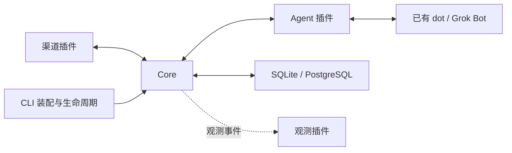

# Relanox 架构

Relanox 是常驻消息网关：接收渠道文字，持久交给用户已有的 dot 或 Grok Bot，再把异步结果发回原会话。它不运行模型。支持范围见 [README](../README.md)，配置与部署见 [CLI](CLI.md) 和 [运维指南](OPERATIONS.md)。

## 模块与依赖

| 模块          | 职责                                                                          |
| ------------- | ----------------------------------------------------------------------------- |
| SDK           | 消息、配置、Host 和四类插件契约；不依赖具体运行实现。                         |
| Core          | 授权、固定绑定、接收去重、领取、结果关联、重试决策、HTTP 路由与单批后台处理。 |
| Channel       | 平台鉴权、消息规范化、独立发送与平台回执映射；不选择 Agent 或直接操作数据库。 |
| Agent         | dot/Grok 认证与传输、MCP 工具和通知；不维护第二套业务队列。                   |
| Storage       | 表、索引、初始化和原子操作；不决定授权、路由或重试策略。                      |
| Observability | 日志、指标和 trace；不参与业务事务。                                          |
| CLI           | 配置装配、HTTP listener、后台循环、常驻连接和管理命令。                       |

Core 和插件依赖 SDK，CLI 依赖具体实现。插件通过 Host 接收、领取和完成消息，以及访问各自命名空间的协议状态。Storage 执行原子条件，Core 决定业务状态转换。精确接口与事务契约见 [SDK](SDK.md) 和 [Core API](CORE.md)。

### 源码职责与维护入口

包级入口保持稳定；下表是包内部职责，不增加公共 subpath API。内部模块直接导入所属实现，避免从本包的 `index.ts` 反向导入形成循环依赖。

| 位置                                 | 职责与修改入口                                                                                                                                                                                                                         |
| ------------------------------------ | -------------------------------------------------------------------------------------------------------------------------------------------------------------------------------------------------------------------------------------- |
| `packages/sdk/src`                   | values/config/messages/state/storage/observability/plugins 分别定义基础值、配置、消息、插件状态、存储、观测和 Host 契约，`index.ts` 统一导出。                                                                                         |
| `packages/core/src/config`           | `schema.ts` 定义配置结构与字段；`relations.ts` 校验唯一性和引用；`plugins.ts` 校验全部插件并构建路由索引；`index.ts` 提供解析。密钥和 JSON 快照分别由 core 的 `secrets.ts`、`json.ts` 负责。                                           |
| `packages/core/src/hosts`            | common 管路由/命名空间/连接观测，channel 管入站授权与快照，agent 管领取/结果授权，setup 在全量校验后建立完整连接清单，再调用插件 setup；tracing 记录 Host 操作。                                                                       |
| `packages/core/src/worker`           | options 校验参数，runtime 拥有逐条领取/调用期限/结算/健康状态，outcomes 校验插件结果，retry 维护预算与退避。                                                                                                                           |
| `packages/core/src/runtime.ts`       | 组装 Host、HTTP、后台任务与运维接口；`http.ts` 管请求大小/取消/错误映射；`administration.ts` 管查询/清理/显式恢复。                                                                                                                    |
| `plugins/channel-*/src`              | config 只依赖 Zod，拥有字段约束、默认值和 URL 策略；schemas 管事件/目标/回执结构，不导入 I/O 实现。channel 管账号运行对象，transport/io/socket/wire 管 I/O；gateway/client/inbound 按协议职责分工，连接与恢复状态由单一对象管理。      |
| `plugins/storage-*/src`              | database/lifecycle/requests/work/plugin-state/inspection 分别管事务底座、初始化、请求原子操作、租约结算、插件 CAS 和运维读取/保留；record-codec/record-contracts 管持久编码与记录约束，事务体不跨模块拆散。                            |
| `plugins/agent-*/src`                | config 拥有 MCP/callback 配置结构，secrets 负责凭据操作，运行模块依赖配置。dot 的 Events、订阅和 dispatch 分工明确，后两者仅接收所需 state；Grok 的 routine 和 MCP 共享 request-payload 投影。MCP 与 callback 保持各自协议和安全边界。 |
| `plugins/observability-standard/src` | 配置、字段脱敏、日志背压、指标、trace、生命周期分别维护，入口负责装配与异常隔离。                                                                                                                                                      |
| `apps/cli/src`                       | config-schema 定义应用配置，config 读取文件；plugins 集中装配十五个渠道和两个 Agent。runtime/listeners/worker/lifecycle 管常驻进程，admin 调用运维接口，storage 管存储创建和健康检查。                                                 |

## 持久交接

数据库保存三类记录：inbound 保存请求、冻结快照、领取令牌和通知进度；outbound 保存最终回复、分片、发送进度与回执；plugin_state 保存订阅、会话游标等命名空间协议状态。

1. 渠道验证事件，Core 检查发送者和绑定，在数据库提交后确认接收。去重键包含平台、账号和稳定事件 ID。
2. 接纳时冻结 endpoint、凭据引用和可序列化回复目标。后续修改绑定不会重定向旧请求，Agent 不能自行指定回复地址。
3. 后台循环从数据库领取到期工作。Grok Webhook 携带正文，dot Events 提醒后通过工具读取；短 dispatch 调用不等待远端任务完成。
4. Agent 按授权范围领取请求，取得 claimToken。每个 endpoint 只有一个活跃请求；相同 claimKey 重试返回同一领取结果。
5. complete 校验令牌，在同一事务中保存最终结果并创建 outbound。相同结果重放是幂等的，不同最终结果发生冲突。
6. 渠道按冻结目标发送分片，保存每片回执。确定的临时失败可以退避重试；未知发送结果保留状态，要求显式恢复。

短执行 lease/version 防止多个工作者重复结算；版本校验不能撤销已经发出的网络请求。长期 claim 不因重启或计时超时释放，管理员重新排队会撤销旧令牌。平台无幂等发送或查询能力时，无法保证外部副作用恰好一次。

持久事实只在数据库中，不增加独立队列服务。重启后扫描继续推进已提交工作；没有补发协议的连接无法保证断线前消息不丢。清理只处理完成记录，保留必要去重信息，不删除未完成请求或未送达结果。

## 运行与安全边界

每个实例选择一个权威 Storage。SQLite 与 PostgreSQL 实现相同原子契约，启动时幂等创建缺失的表和索引。诊断命令保持只读。CLI 启动时校验配置、初始化并检查存储，再注册 handler、启动连接和后台循环；关闭时停止接收、结束短调用并释放资源。

渠道和 Agent 分别鉴权；正文不授予权限。环境凭据在使用时解析，不写入消息快照或日志。dot 回调限制目标、DNS 地址和重定向，HTTP 请求体与外部调用均有限额。账户接入和协议限制见 [Agent 协议](AGENTS_PROTOCOL.md) 与 [渠道配置](CLI.md)。

管理健康检查和指标使用独立回环 listener；公开 MCP/Webhook 应通过 HTTPS 访问。观测失败不能阻断消息处理，日志排除正文和密钥，指标标签使用有限集合。trace 仅关联本地交接阶段，不跟踪远端推理；完整配置见 [可观测性](OBSERVABILITY.md)。

测试使用真实存储和本地协议对端，验证授权、事务、重启恢复与发送边界；它们不等同于真实平台账户验证。开发检查和测试运行方法见 [开发指南](DEVELOPMENT.md)。
